<div align="center">

# Seedline

### One seed, one circuit — a deterministic time-trial racer.

Every 16-character seed builds the same track, every time. Race it, record a best,
share the code, and let the next driver chase your ghost.

[](https://godotengine.org)
[](https://docs.godotengine.org/en/stable/tutorials/scripting/gdscript/index.html)
[](https://heroiclabs.com/nakama/)
[](https://docs.godotengine.org/en/stable/tutorials/rendering/index.html)


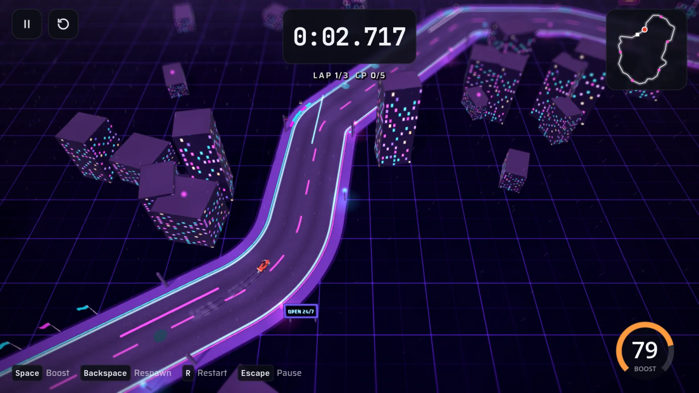

</div>

---

Seedline is a precision time-trial racer built in **GDScript on Godot 4.7**. A seed deterministically
generates a repeatable circuit — its bends, checkpoints, scenery, weather and boost pads — so two
players who share a code race the exact same track. Find the line, set the time, and run it back.

## Screenshots

<table>
  <tr>
	<td width="50%">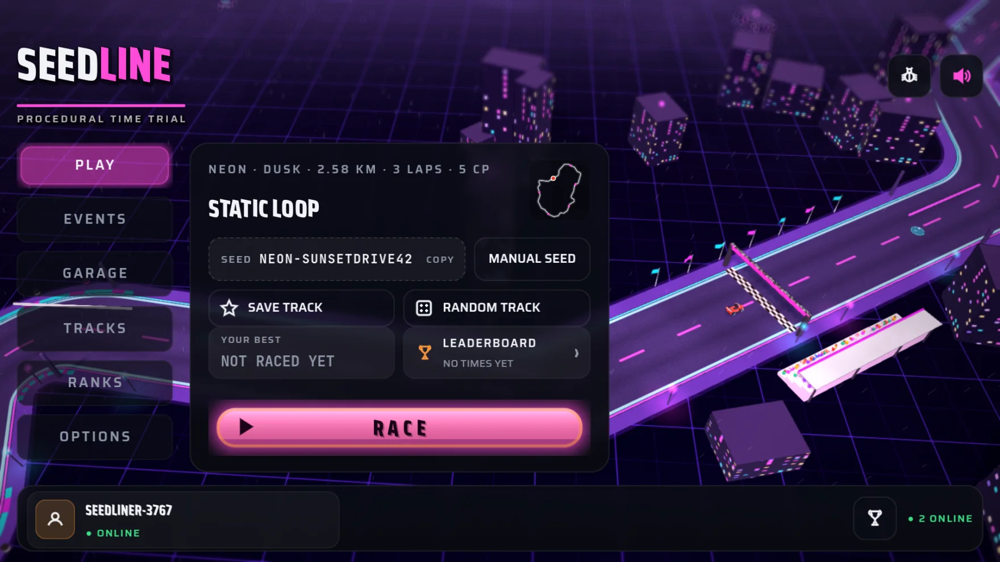</td>
	<td width="50%">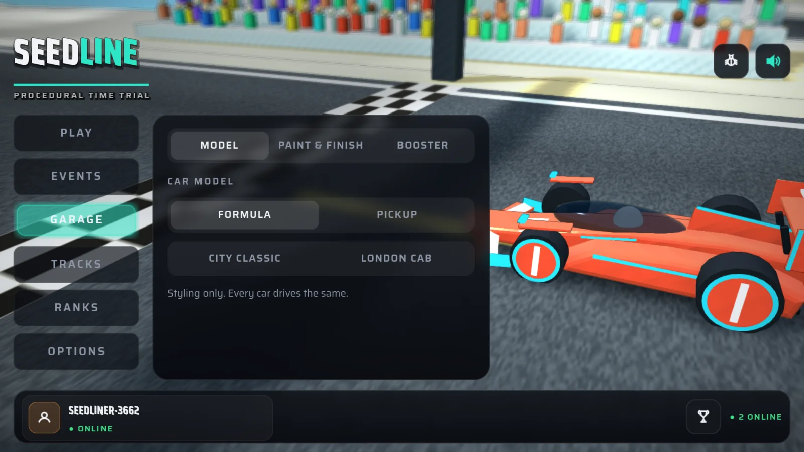</td>
  </tr>
  <tr>
	<td align="center"><b>Play</b> — roll or paste a seed, preview the track, race.</td>
	<td align="center"><b>Garage</b> — tune paint, finish and booster color.</td>
  </tr>
  <tr>
	<td width="50%">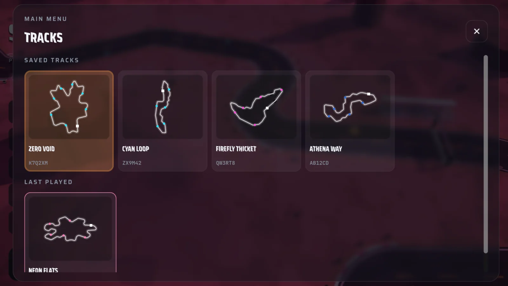</td>
	<td width="50%">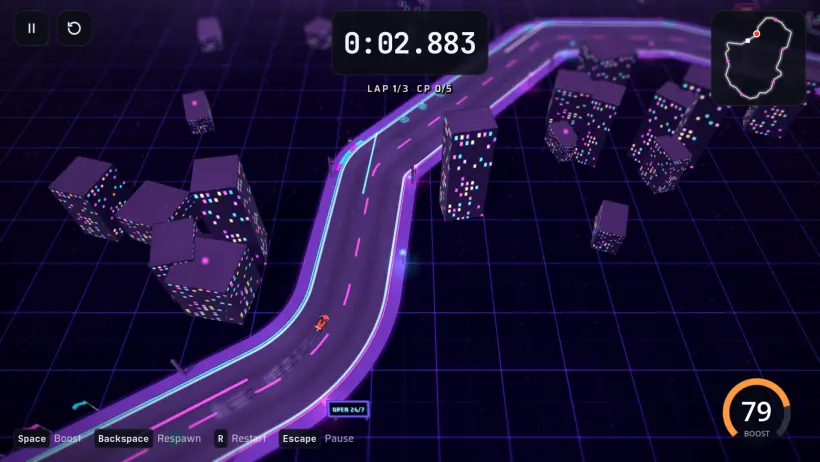</td>
  </tr>
  <tr>
	<td align="center"><b>Tracks</b> — saved &amp; recent circuits, each with its seed.</td>
	<td align="center"><b>Race</b> — 120 Hz handling, drift, boost and pickups.</td>
  </tr>
</table>

## Features

- **Seed-built tracks** — sixteen available environments with generated scenery, checkpoints, weather,
  terrain and boost pads, plus a cached minimap preview for every saved track.
- **Precision driving** — a fixed 120 Hz car simulation, three-lap races, drift and boost, track
  boundaries, and ordered anti-cut gates.
- **Runs & replays** — personal bests, lap splits, saved and recently played tracks, and recorded
  best-run replays that play back the original inputs through normal physics and boost logic.
- **Ghost comparisons** — race your own best and up to ten rival ghosts on the same seed, with a
  finish-time comparison against your selected racer.
- **Progression** — daily and weekly seed challenges, account milestones, and monthly seasonal
  Performance Points standings.
- **Garage & options** — customize car paint and booster color; adjust graphics and rebind
  keyboard and gamepad controls. Touch controls adapt for phones and tablets.
- **Responsive UI** — Play, Garage, Tracks, Events and Options are designed for desktop, tablet and
  mobile, with keyboard, gamepad and touch navigation.

## Worlds

Sixteen hand-tuned environments are currently available, each with its own terrain, weather,
lighting and scenery. The environment is derived from the seed, or forced with a seed prefix — e.g.
`GRID-LIGHTCYCLE77`. Metro blends a dusk skyline, Art Deco tower, palms, streetcars and rain-lit avenues.
Orbital Habitat adds a starfield, ringed planet, and detailed solar-array stations. Crystal Caverns
descends through vaulted stone arches, luminous mineral spires and drifting crystal dust.

<table>
  <tr>
	<td width="25%">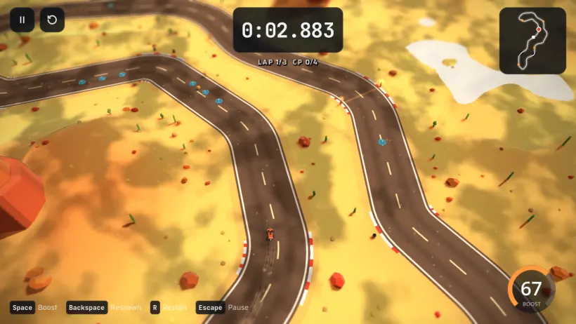<p align="center"><b>Canyon</b><br><sub>Red-rock desert</sub></p></td>
	<td width="25%">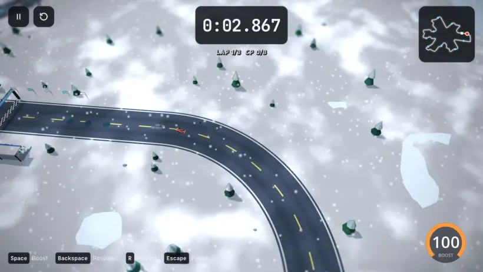<p align="center"><b>Alpine</b><br><sub>Snowbound peaks</sub></p></td>
	<td width="25%"><p align="center"><b>Neon</b><br><sub>Synthwave city</sub></p></td>
	<td width="25%">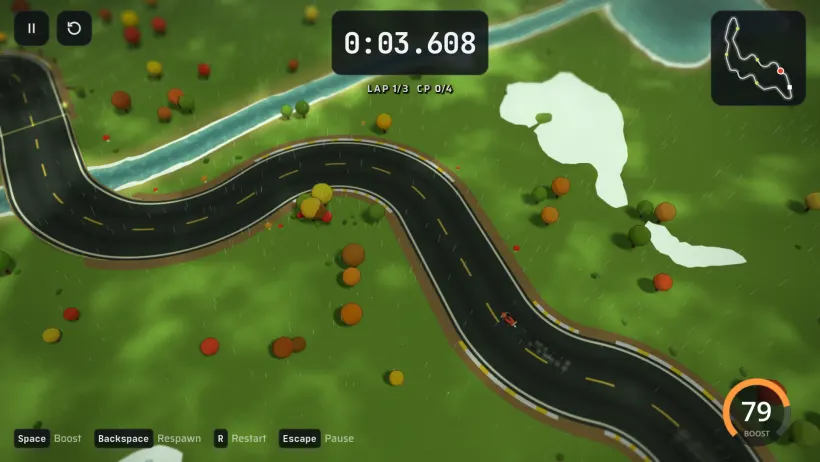<p align="center"><b>Grove</b><br><sub>Rainy woodland</sub></p></td>
  </tr>
  <tr>
	<td>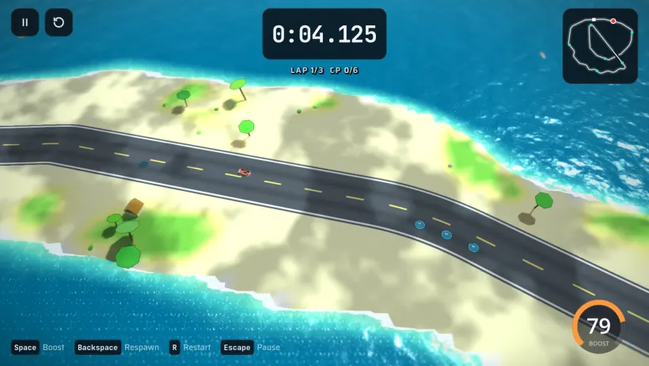<p align="center"><b>Island</b><br><sub>Tropical coast</sub></p></td>
	<td>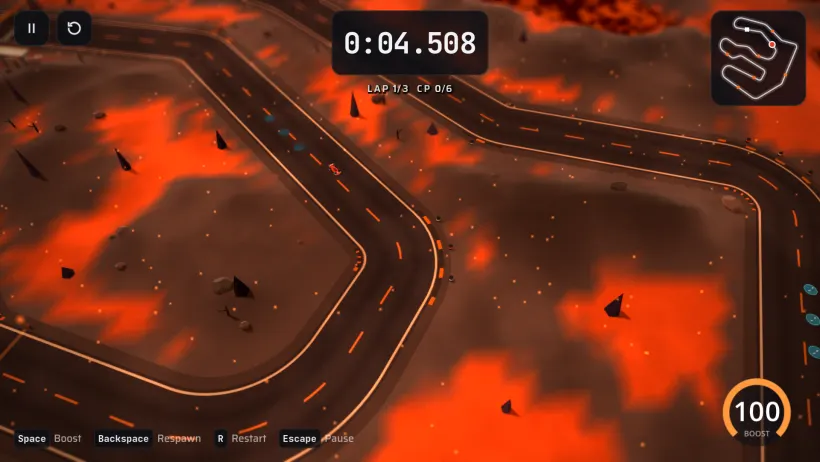<p align="center"><b>Volcano</b><br><sub>Lava fields</sub></p></td>
  </tr>
  <tr>
	<td>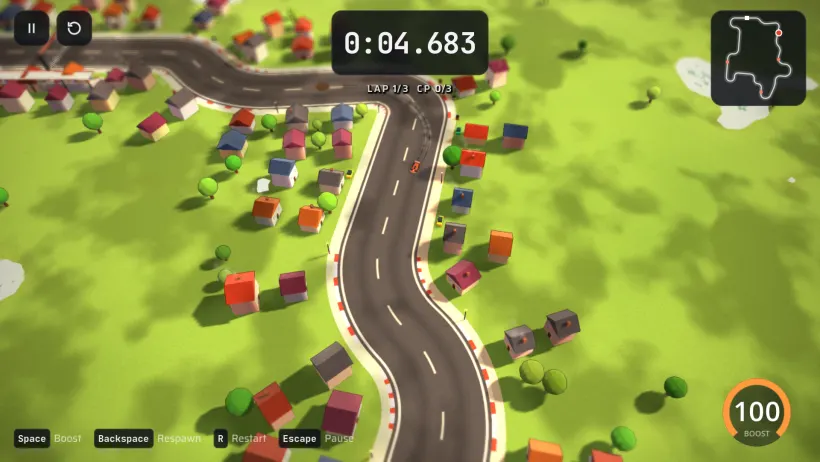<p align="center"><b>Old Town</b><br><sub>Cobbled streets</sub></p></td>
	<td>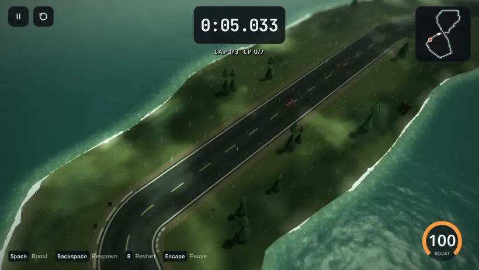<p align="center"><b>Wetlands</b><br><sub>Misty bayou</sub></p></td>
	<td>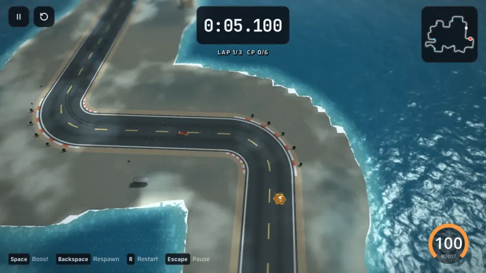<p align="center"><b>Harbor</b><br><sub>Working docks</sub></p></td>
	<td>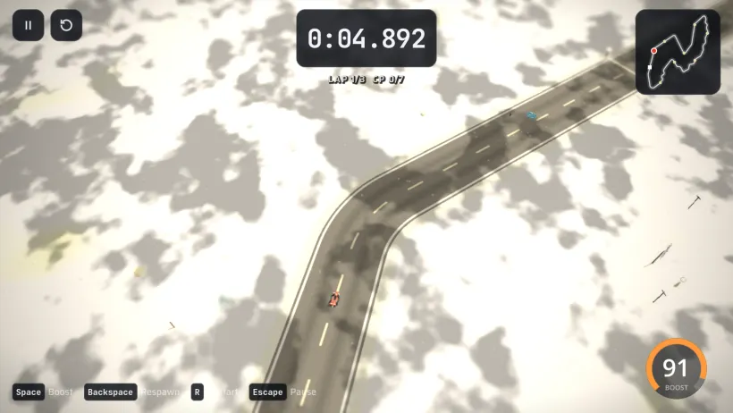<p align="center"><b>Salt Flats</b><br><sub>Mirror pan</sub></p></td>
  </tr>
  <tr>
	<td>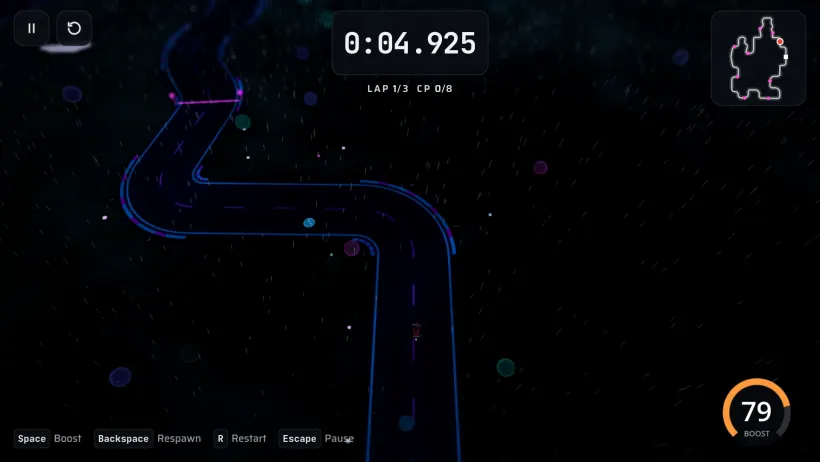<p align="center"><b>Nocturne Bloom</b><br><sub>Bioluminescent jungle</sub></p></td>
	<td>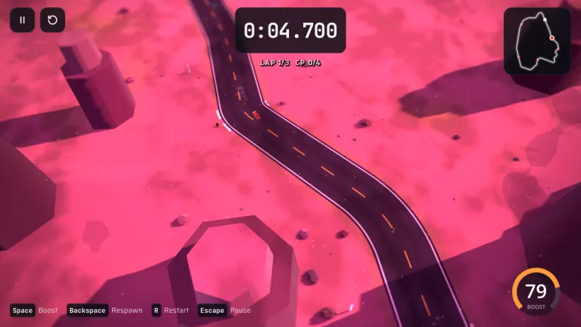<p align="center"><b>Dusk Mesa</b><br><sub>Vaporwave desert</sub></p></td>
	<td>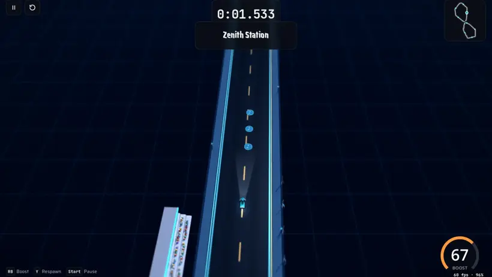<p align="center"><b>Orbital Habitat</b><br><sub>Ringed planet and station arrays</sub></p></td>
	<td>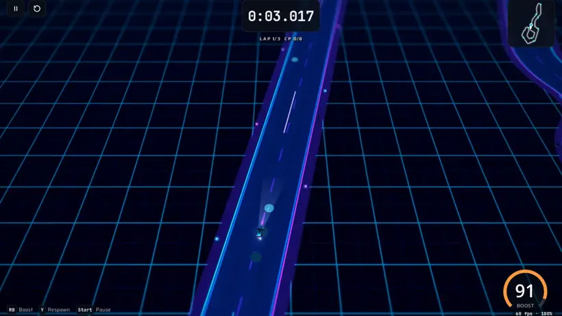<p align="center"><b>Grid</b><br><sub>Lightgrid void</sub></p></td>
  </tr>
  <tr>
	<td>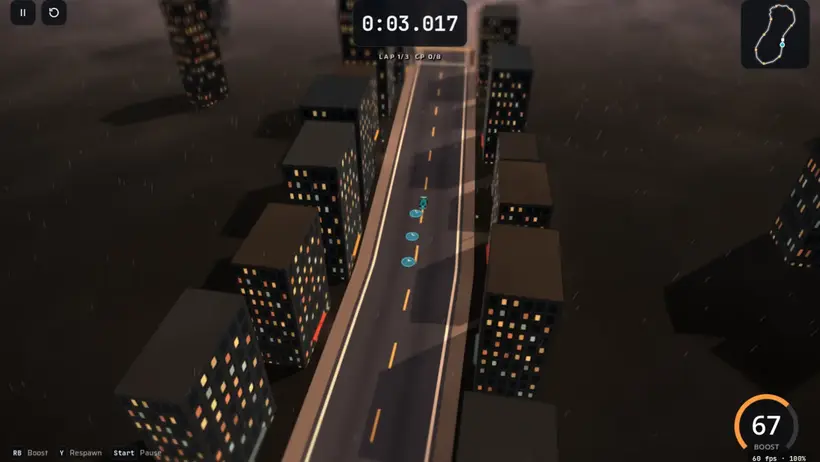<p align="center"><b>Metro</b><br><sub>Dusk skyline and rain-lit avenue</sub></p></td>
	<td>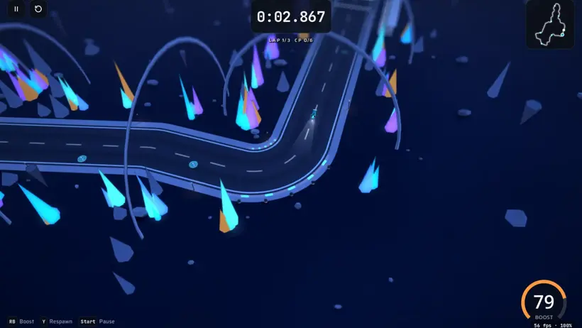<p align="center"><b>Crystal Caverns</b><br><sub>Bioluminescent geodes and cavern arches</sub></p></td>
  </tr>
</table>

## Getting started

Seedline is written in GDScript and builds its tracks, world props, car, effects and UI at runtime.
It targets Godot's **Compatibility renderer** (OpenGL 3 / WebGL 2) and supports keyboard, gamepad and
touch input. Local settings, saved tracks, bests and replay data live in `user://seedline.json`.

Requires **Godot 4.7.x**. Clone the repo and run:

```sh
make godot
# or point at a specific binary:
make godot GODOT=/path/to/godot
```

Run `make help` to list all available targets.

## Online services (Nakama)

The Nakama Lua runtime and Postgres backend provide per-track and event leaderboards, global and
monthly seasonal Performance Points, account progression and achievements, online presence,
account-linked car settings, and stored opponent ghost paths. Runs are validated and idempotent;
when the service is unavailable the game stays playable offline and queues finished runs for retry.

See [server/README.md](server/README.md) for the RPCs, local deployment, validation and production
configuration.

## Website

The responsive landing page is a standalone [Vite](https://vite.dev) app in [website/](website/),
using captured screenshots from the running game.

```sh
make website-install   # install dependencies
make website           # dev server
make website-build     # production build
make website-preview   # preview the production build
```

## Repository layout

```text
scenes/       Main Godot scene
scripts/      Track generation, car simulation, networking, UI, and world rendering
shaders/      World, car, weather, and post-processing shaders
server/       Nakama Lua runtime and local deployment files
website/      Vite landing page and captured game screenshots
tools/        Track, replay, screenshot, and performance helpers
```

The `server/` and `website/` folders carry `.gdignore` markers and are excluded from Godot's
resource scan and project imports.

## License

No license has been declared for this repository yet, so default copyright applies and all rights
are reserved by the author. A license file will be added here if the project is opened for reuse.
